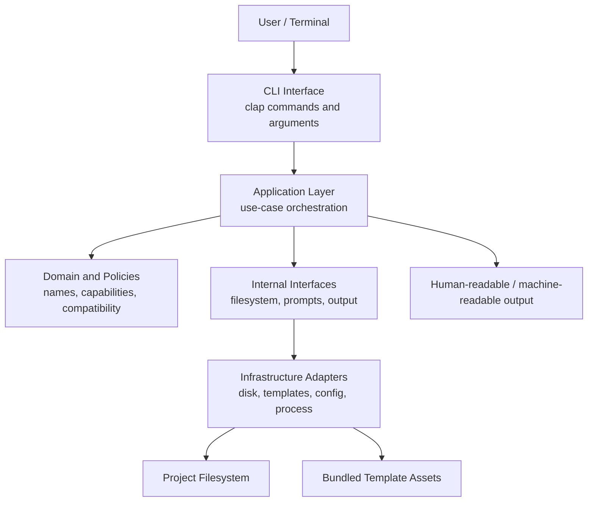
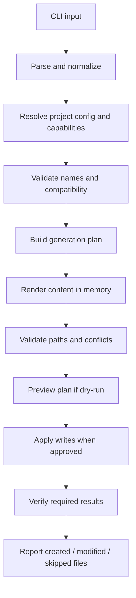

# Architecture — `rustrs`

> **Project:** `rustrs` — Rust API scaffolding CLI  
> **Document status:** Proposed architecture baseline  
> **Audience:** Maintainers and AI coding agents  
> **Primary source of product requirements:** `PRD.md`  
> **Implementation roadmap:** `docs/roadmap/phase-0-repository-bootstrap.md` and subsequent phase documents

---

## 1. Purpose

This document defines the architectural boundaries, technical direction, module responsibilities, and engineering rules for `rustrs`.

`rustrs` is a command-line application written in Rust that scaffolds REST API projects and generates application code from supported templates. Its intended experience is similar to a framework CLI: users invoke commands, answer configuration questions when appropriate, and receive a project or code changes that can be inspected, tested, and maintained.

This document is an architecture guide, not a claim that every described module or command already exists. Implementation must follow the phase roadmap and must not present planned features as working features.

### 1.1 Architectural goals

- **Correctness first:** generated projects must be coherent, buildable, and compatible with the selected options.
- **Explicit support:** only combinations listed in the compatibility matrix may be generated.
- **Safe filesystem behavior:** preview changes, detect conflicts, prevent path traversal, and avoid destructive writes by default.
- **Separation of concerns:** CLI parsing, use-case orchestration, domain decisions, template rendering, and filesystem effects must remain distinguishable.
- **Testability:** core decisions should be testable without launching a process, accessing a network, or modifying the user's real project.
- **Incremental implementation:** modules are introduced when their owning phase requires them.
- **Maintainability:** favor ordinary Rust types and explicit data flow over a large plugin system or premature abstraction.
- **Good CLI UX:** provide useful help, actionable errors, stable exit behavior, and predictable output.
- **Cross-platform behavior:** support Windows, macOS, and Linux to the extent defined by the release plan.

---

## 2. Product context and boundaries

### 2.1 Planned capabilities

The complete product is expected to support:

- `rustrs new <project-name>` for project scaffolding.
- Code generators for resources, modules, controllers, services, repositories, models/entities, DTOs, middleware, guards, validators, jobs, events, handlers, tests, and migrations, subject to the selected template's capabilities.
- Templates: Enterprise API, Standard API, Simple API, and Minimal API.
- Configuration and project inspection.
- Diagnostics and environment validation.
- Database and development workflows.
- Quality checks, API documentation, Docker assets, CI/CD templates, and release distribution.

These are product goals, not Phase 0 deliverables. The phase roadmap controls when each feature is implemented.

### 2.2 Enterprise template as reference architecture

The Enterprise API template is the reference/superset application architecture. Its planned baseline is:

- Stable Rust, Tokio, Axum, PostgreSQL, and SQLx.
- Modular feature-oriented organization.
- Clean Architecture-inspired dependency direction where it provides practical value.
- Explicit separation between transport handlers, application use cases, domain rules, and infrastructure adapters.
- Authentication, authorization, validation, observability, API documentation, testing, and operational capabilities enabled according to the template's support matrix.

Other templates are intentionally smaller profiles, not separate CLI architectures. They reuse the same scaffolding engine and capability model while emitting different application structures.

### 2.3 Important distinction

There are two separate architectures:

1. **The `rustrs` CLI architecture** — how this tool parses commands, validates options, renders templates, and safely writes files.
2. **The generated API architecture** — how an application produced by `rustrs` organizes handlers, services, repositories, domain logic, and infrastructure.

Do not mix these concerns. For example, the generated API's repository pattern is not automatically a requirement for the CLI's own internal modules.

---

## 3. Core architectural decisions

The following are the proposed defaults. If the PRD or project owner explicitly chooses a different option, update this section before implementing the affected phase.

| Area                  | Decision                                                                                                        | Rationale                                                                                                                                            |
| --------------------- | --------------------------------------------------------------------------------------------------------------- | ---------------------------------------------------------------------------------------------------------------------------------------------------- |
| Language              | Stable Rust                                                                                                     | Portable, predictable builds and broad ecosystem support.                                                                                            |
| Package model         | One Cargo binary package initially                                                                              | Avoids workspace complexity until multiple crates provide a real benefit.                                                                            |
| CLI parsing           | `clap` with derive API                                                                                          | Typed command definitions, generated help/version output, and standard command-line behavior.                                                        |
| Interactive prompts   | Add `dialoguer` or `inquire` only when implementing the wizard                                                  | Keep the foundation small and avoid prompt dependencies in non-interactive workflows.                                                                |
| Terminal output       | `std` initially; consider `console` and `indicatif` for styling/progress                                        | Avoid making every command depend on decorative output.                                                                                              |
| Error handling        | `anyhow` at application/use-case boundaries; `thiserror` for errors that need stable typed variants             | Convenient context at the CLI boundary while preserving typed errors where callers need to match them.                                               |
| Serialization/config  | `serde` plus `toml` for the project manifest                                                                    | Typed configuration and readable configuration files.                                                                                                |
| Template engine       | Evaluate `Tera` as the default candidate; keep template rendering behind an internal interface                  | Tera supports template parsing, context, filters, inheritance, and includes. Validate generated Rust syntax and escaping behavior before finalizing. |
| Filesystem            | `std::path` and `std::fs` behind a filesystem boundary; add `walkdir` only when recursive traversal is required | Keeps file operations explicit and testable.                                                                                                         |
| Safe temporary writes | Use a well-maintained temporary-file crate if atomic replacement is needed                                      | Avoid hand-rolled temporary-file naming and partial writes.                                                                                          |
| Tests                 | Unit tests, integration tests, `assert_cmd`, `predicates`, `tempfile`, and snapshot tests when useful           | Verify core logic, real CLI behavior, generated files, and failure cases.                                                                            |
| Dependency policy     | Add dependencies only for a demonstrated phase requirement                                                      | Limits compile cost, maintenance, and supply-chain exposure.                                                                                         |
| Async runtime         | Do not introduce Tokio into the CLI unless an actual CLI feature needs asynchronous I/O                         | The generated API may use Tokio, but that does not imply the scaffolding CLI needs it.                                                               |

### 3.1 CLI framework

Use `clap` as the default CLI parser when Phase 1 is implemented. Prefer typed structs and enums with the derive API for commands and arguments. Avoid manually parsing `std::env::args()` except for a narrowly justified bootstrap case.

The CLI layer should define the public command contract, but should not contain template-rendering or filesystem-generation logic.

### 3.2 Error strategy

- Use typed domain errors when the caller needs to distinguish conditions such as unsupported combinations, conflicting files, invalid configuration, or invalid names.
- Attach contextual information to errors as they move toward the CLI boundary.
- Print concise, actionable errors to stderr.
- Never expose backtraces or internal implementation details by default.
- Use non-zero exit codes for failed operations.
- Do not convert errors into success-shaped output or silently ignore failures.

### 3.3 Dependency version policy

Use current stable crate versions at implementation time, subject to MSRV and compatibility checks. Do not hard-code version numbers into this document as permanent recommendations. Commit `Cargo.lock` for reproducible application builds and review dependency updates rather than accepting them blindly.

---

## 4. High-level architecture

The CLI uses a layered, use-case-oriented design. This is a lightweight separation of concerns, not a requirement to create a crate for every layer.



### 4.1 CLI interface layer

Responsibilities:

- Define command names, arguments, options, aliases, and help descriptions.
- Parse input into typed values.
- Enforce simple syntactic constraints where `clap` can do so.
- Delegate execution to application use cases.
- Convert the final outcome into a suitable exit code and user-facing output.

Must not:

- Render templates directly.
- Write generated files directly.
- Embed compatibility rules across individual command handlers.
- Contain large business workflows.

### 4.2 Application layer

Responsibilities:

- Coordinate complete operations such as creating a project, generating a resource, inspecting a project, or running diagnostics.
- Validate the operation's prerequisites.
- Call domain policies and infrastructure adapters.
- Coordinate planning, preview, conflict checks, and execution.
- Return structured results suitable for terminal output and testing.

Application use cases should be ordinary Rust functions or small structs with explicit inputs and outputs. Introduce dependency injection only where it improves testability or allows a real implementation choice.

### 4.3 Domain and policy layer

Responsibilities:

- Represent template IDs, framework choices, database choices, architecture choices, capabilities, and compatibility constraints.
- Validate names and normalize identifiers.
- Decide whether a requested feature is supported by a template/configuration combination.
- Define generation operations and planned file changes as data.
- Represent stable error categories when callers need to branch on them.

This layer should not read or write files, prompt users, spawn processes, or depend on terminal output.

### 4.4 Infrastructure layer

Responsibilities:

- Load and save configuration.
- Read bundled template assets.
- Render templates.
- Inspect and modify project files.
- Execute explicitly requested external commands such as Cargo or Docker, when a later phase owns that capability.
- Implement filesystem and process adapters used by application use cases.

Infrastructure code must not independently decide whether a feature combination is supported. It follows decisions from the domain/policy layer.

### 4.5 Output and interaction

Keep user-facing output separate from core decisions. Human-readable output is the default. If machine-readable output such as JSON is introduced later, define it as a deliberate, stable interface rather than parsing terminal text.

Interactive prompts should be an input adapter to the same application request used by non-interactive flags. This allows automation and CI usage without a terminal.

### 4.6 Phase 1 implementation notes

Phase 1 implemented the initial CLI foundation:

- `clap` derive API in `src/cli/mod.rs` with root help/version and global options `--verbose`, `--quiet`, and `--no-color`.
- `--verbose` and `--quiet` conflict; `--no-color` disables application styling.
- Execution errors are represented by `src/error.rs` and mapped to exit codes; parse errors remain Clap's responsibility.
- Candidate project-root discovery lives in `src/project/root.rs` and detects an ancestor containing `Cargo.toml`; it does not validate a `rustrs` manifest.
- Output policy is centralized in `src/cli/output.rs`.

### 4.7 Phase 2 implementation notes

Phase 2 implemented typed manifest and compatibility foundations:

- `src/manifest` defines `ProjectManifest`, typed technology enums, `Features`, parsing, validation, schema version 1, and read-only manifest discovery.
- `src/compatibility` owns the compatibility matrix, resolver, status reporting, and capability dependency validation.
- Unknown manifest fields are rejected with `deny_unknown_fields`.
- Only `Axum + Postgres + SQLx` is currently supported; other recognized combinations are unsupported without silent fallback.
- `rbac` requires `auth`; manifest I/O failures map to exit code 1, configuration/compatibility failures map to exit code 2.
- Discovery searches for `.rustrs/config.toml` without writing or canonicalizing paths.

### 4.8 Phase 3 implementation notes

Phase 3 implemented the template and filesystem engine:

- `src/template` defines template metadata, fixture assets, resolver, context, asset selection, and Tera rendering with autoescape disabled for code/config output.
- `src/generation` defines the generation plan and planning pipeline without filesystem writes.
- `src/filesystem` validates paths, detects conflicts, applies plans with atomic writes, and produces dry-run previews and operation reports.
- Only `TemplateId::Minimal` had a fixture template; other templates remained unavailable until Phase 4.
- Path traversal, absolute paths, and symlink escapes are rejected.
- Existing files are preserved by default.

### 4.9 Phase 4 implementation notes

Phase 4 implemented project scaffolding:
- `src/cli` defines the `new` subcommand with typed flags and global options.
- `src/application/new_project.rs` orchestrates input resolution, wizard, compatibility preflight, planning, dry-run, apply, manifest read-back, and reporting.
- `src/template/metadata.rs` now provides buildable starter templates for Minimal, Simple, Standard, and Enterprise (all currently Axum + Postgres + SQLx).
- `build_plan` now appends `.rustrs/config.toml` serialized from the final manifest (single source of truth).
- Dry-run uses the same plan as apply and does not mutate the filesystem.
- Existing targets are preserved unless explicitly empty; conflicts return exit code 3.
- Git initialization is not exposed in Phase 4.

---

## 5. Proposed source layout

Start with a single package. Add modules gradually as implementation phases introduce actual responsibilities.

```text
rustrs/
├── src/
│   ├── main.rs
│   ├── cli/
│   │   ├── mod.rs
│   │   ├── commands.rs
│   │   └── output.rs
│   ├── application/
│   │   ├── mod.rs
│   │   ├── new_project.rs
│   │   ├── generate.rs
│   │   └── inspect.rs
│   ├── domain/
│   │   ├── mod.rs
│   │   ├── template.rs
│   │   ├── capability.rs
│   │   ├── compatibility.rs
│   │   ├── naming.rs
│   │   └── generation.rs
│   ├── manifest/
│   │   ├── mod.rs
│   │   ├── model.rs
│   │   ├── parser.rs
│   │   ├── validation.rs
│   │   ├── discovery.rs
│   │   └── error.rs
│   ├── compatibility/
│   │   ├── mod.rs
│   │   ├── types.rs
│   │   ├── matrix.rs
│   │   ├── resolver.rs
│   │   └── capabilities.rs
│   ├── template/
│   │   ├── mod.rs
│   │   ├── metadata.rs
│   │   ├── resolver.rs
│   │   ├── context.rs
│   │   ├── asset.rs
│   │   └── renderer.rs
│   ├── generation/
│   │   ├── mod.rs
│   │   ├── plan.rs
│   │   └── planner.rs
│   ├── filesystem/
│   │   ├── mod.rs
│   │   ├── paths.rs
│   │   ├── conflicts.rs
│   │   ├── writer.rs
│   │   └── report.rs
│   ├── config/
│   │   ├── mod.rs
│   │   ├── manifest.rs
│   │   └── loader.rs
│   ├── templates/
│   │   ├── mod.rs
│   │   ├── resolver.rs
│   │   └── renderer.rs
│   ├── filesystem/
│   │   ├── mod.rs
│   │   ├── planner.rs
│   │   ├── writer.rs
│   │   └── conflict.rs
│   ├── diagnostics/
│   │   ├── mod.rs
│   │   └── doctor.rs
│   └── error.rs
├── templates/
│   ├── enterprise-api/
│   ├── standard-api/
│   ├── simple-api/
│   └── minimal-api/
├── tests/
├── docs/
│   └── roadmap/
├── Cargo.toml
├── Cargo.lock
├── README.md
├── ARCHITECTURE.md
├── AGENTS.md
└── PRD.md
```

This is a **target direction**, not a Phase 0 checklist. Do not create empty files/directories for every future module. Introduce each module only when its phase needs it.

### 5.1 `main.rs`

Keep `main.rs` thin. It should:

1. Build/parse the CLI definition.
2. Call the selected command's application entry point.
3. Convert errors into user-facing diagnostics and an exit code.

Do not put project generation, compatibility policy, configuration parsing, or template rendering in `main.rs`.

### 5.2 When to split into multiple crates

Do not begin with a workspace or separate crates by default. Consider a workspace only when a concrete boundary emerges, such as:

- A reusable public library is intended in addition to the binary.
- Template engine logic must be independently versioned or reused.
- Separate crates materially improve compile times, dependency isolation, or API contracts.
- Multiple maintained binaries become necessary.

A workspace has shared package/build conventions and a shared lockfile, but it adds coordination overhead. Revisit this decision when evidence justifies it.

---

## 6. Command model

The command tree is the public interface of the CLI. Names and options must be documented and tested.

### 6.1 Planned top-level commands

```text
rustrs
├── new <project-name>
├── generate <kind> <name>       # alias: g
├── config <show|get|set>
├── info
├── routes
├── modules
├── deps
├── doctor
├── db <migrate|rollback|status|seed|create-migration>
├── dev [--watch]
├── dev <up|down|logs>
├── check
├── lint
├── test
├── format
├── audit
└── docs
```

This is a planning sketch, not a final grammar. Some commands may be grouped or renamed during Phase 1 based on the PRD. Do not implement this entire list in Phase 0.

### 6.2 Command rules

- Use consistent verbs and option names.
- Provide `--help` and `--version`.
- Prefer explicit flags for automation and CI.
- Interactive prompts must be skippable through flags or a non-interactive mode where practical.
- If required information is missing in non-interactive mode, fail with a clear message instead of hanging for input.
- `--dry-run` must not modify the filesystem.
- `--force` must have documented conflict/overwrite semantics.
- Commands must return meaningful non-zero exit codes on failure.
- Never claim an operation succeeded until its side effects have completed and been verified to the degree appropriate for the operation.

---

## 7. Project creation and configuration model

### 7.1 Configuration sources

When configuration support is implemented, use a documented precedence order. Proposed order, highest priority first:

1. Explicit CLI arguments and flags.
2. Environment variables for documented overrides.
3. Project-level `.rustrs/config.toml`.
4. Template defaults.

Do not add a global user configuration file until there is a concrete requirement and its precedence/security behavior is specified.

### 7.2 Project manifest

The project-level manifest should identify enough information for `rustrs` to inspect and safely operate on a generated project. Proposed location:

```text
.rustrs/
└── config.toml
```

The manifest should be versioned and validated. It may include:

- Manifest schema version.
- `rustrs` generator version.
- Selected template and template version.
- Framework, database, and driver/ORM choices.
- Architecture profile.
- Enabled capabilities.
- Generation metadata needed for future compatibility.

Requirements:

- Reject unknown incompatible schema versions with an actionable error.
- Use explicit defaults and validate the complete resolved configuration.
- Do not persist secrets in this manifest.
- Do not assume that a project is managed by `rustrs` merely because a directory has a similar name.
- Preserve user-owned settings when updating configuration.
- Define migration behavior before changing the manifest schema after release.

### 7.3 Capability model

Treat capabilities as explicit configuration, not scattered booleans hidden in template code.

Examples include authentication, authorization, OpenAPI, Redis, background jobs, email, object storage, audit logging, idempotency, Docker, CI, and observability.

The capability resolver must:

1. Read the requested template and choices.
2. Validate framework/database/driver compatibility.
3. Validate capability dependencies and conflicts.
4. Produce a fully resolved configuration.
5. Fail before writing files if the combination is unsupported.

A capability is either supported and generated correctly, or rejected clearly. Do not silently ignore a selected capability.

---

## 8. Template system

### 8.1 Principles

- Template files are version-controlled project assets.
- Templates should be deterministic for a given resolved configuration and generator version.
- Keep template resolution separate from rendering and filesystem writes.
- Keep the rendering engine behind a small internal interface so the implementation can be tested and, if necessary, replaced.
- Prefer a readable, consistent naming convention for template files.
- Avoid building a general-purpose plugin system in the MVP.
- Do not execute template content as code.
- Document which template features and configuration combinations are supported.

### 8.2 Resolver and renderer responsibilities

**Template resolver:**

- Resolves the selected template and version.
- Determines which template assets and partials apply.
- Receives a validated configuration.
- Rejects missing or incompatible template assets.

**Template renderer:**

- Receives template text and an explicit, serializable context.
- Renders deterministic file contents.
- Reports missing variables, parse errors, and render errors clearly.
- Does not write to disk.

**Filesystem writer:**

- Receives already-rendered planned changes.
- Applies the plan only after path and conflict validation.
- Does not make template/capability decisions.

### 8.3 Template engine

`Tera` is the initial candidate because it supports template parsing, contexts, filters, inheritance, includes, and cached parsed templates. Confirm its behavior for Rust source files and non-HTML content before committing to it. HTML auto-escaping defaults or assumptions must not accidentally modify generated Rust, TOML, YAML, or shell files.

Template rendering must be tested with representative inputs, including punctuation, Unicode where supported, reserved identifiers, optional capabilities, and invalid/missing context values.

### 8.4 Template metadata

Each template should eventually provide a machine-readable manifest describing:

- Template ID and version.
- Display name and description.
- Supported frameworks.
- Supported database/driver combinations.
- Supported capabilities and dependencies.
- Required and optional prompts/fields.
- Files or file groups to render.
- Any template-specific generator capabilities.

Avoid duplicating compatibility rules across command handlers and individual template files. The compatibility resolver is the source of truth.

### 8.5 Template versioning

The generated project should record which template and generator version produced it. Define an explicit policy before changing a template in a way that affects already-generated projects. The CLI should not silently rewrite existing application code just because a newer CLI is installed.

---

## 9. Code generation and filesystem safety

Filesystem safety is a core product requirement because the CLI writes code into user projects.

### 9.1 Generation pipeline

Every generation operation should follow this pipeline:



Do not start writing files before configuration, compatibility, names, target paths, and conflict behavior have been validated.

### 9.2 Generation plan

Represent changes as structured data, for example:

- Relative target path.
- Operation: create, modify, or skip.
- Rendered content or a deferred content producer.
- Conflict policy.
- Reason/description for the operation.

The exact type can be decided during the filesystem-engine phase. Avoid coupling this model to terminal output.

### 9.3 Path safety

- Accept generated target paths as relative paths within the selected project root.
- Reject absolute paths and parent-directory traversal.
- Normalize and validate paths before writing.
- Do not trust template-provided paths blindly.
- Consider symlink behavior explicitly; do not assume lexical normalization alone prevents escaping the project root.
- Do not follow symlinks outside the target root when creating or modifying generated files.
- Test path traversal and symlink edge cases on supported platforms.
- Never delete arbitrary files as part of normal generation.

### 9.4 Conflict and overwrite policy

- Default behavior must preserve existing user files.
- Detect file conflicts before writing any output where feasible.
- `--force` must not mean “delete the project and recreate it.”
- For modified files, define whether the operation replaces, merges, or rejects the change; do not invent merge semantics.
- Use atomic/temporary-file writes when practical to reduce partial-file risk.
- Report files that were created, modified, skipped, or rejected.
- Make repeated generation predictable and idempotent where the generator contract permits it.

### 9.5 Dry-run

`--dry-run` must produce the same plan as a real run but must not mutate the filesystem. It should report planned file operations and conflicts. Tests must verify that target contents and directory structure remain unchanged.

### 9.6 Transaction limits

A series of filesystem writes is not automatically an atomic transaction. For MVP, aim to validate the complete plan before applying it and minimize partial output. If a write fails mid-operation, report which operations succeeded and which failed. Add rollback machinery only if the product requirements justify its complexity.

---

## 10. Naming and generated code conventions

The CLI should normalize user-provided names once and use the normalized representation consistently.

Potential naming forms include:

- `products` — module/resource plural or collection.
- `Product` — PascalCase type.
- `product` — singular snake_case identifier.
- `product_id` — field/identifier.
- `product_id` or `product-id` only where the target format explicitly calls for it.

Requirements:

- Define naming rules and edge cases in one domain module.
- Reject invalid names instead of silently producing malformed code.
- Handle Rust reserved keywords, raw identifiers, acronyms, numbers, and Unicode according to an explicit policy.
- Avoid naive singularization/pluralization assumptions for irregular words.
- Keep the original input when it is useful for diagnostics, but use normalized names for generated identifiers.
- Test every supported naming transformation.
- Generated Rust must be formatted and compile in representative template fixtures.

---

## 11. Testing strategy

Tests must cover the public CLI contract and the correctness/safety of generated output.

### 11.1 Unit tests

Use unit tests for pure logic such as:

- Name validation and normalization.
- Compatibility rules.
- Capability dependency resolution.
- Configuration validation.
- Template selection.
- Generation-plan construction.
- Conflict policy decisions.
- Error mapping where behavior is important.

These tests should not need a real terminal, database, network, or writes to a real user project.

### 11.2 CLI integration tests

Use process-level tests to verify:

- `--help` and `--version`.
- Valid and invalid arguments.
- Expected exit codes.
- Error messages on stderr.
- Successful command output.
- Non-interactive behavior.
- `--dry-run` does not write files.
- Existing-file conflicts do not silently overwrite content.

Use temporary directories for filesystem tests. `assert_cmd`, `predicates`, and `tempfile` are candidate tools; add them when the relevant tests are implemented.

### 11.3 Template tests

- Render every supported template/configuration fixture.
- Check required files and important contents.
- Test both enabled and disabled optional capabilities.
- Test unsupported combinations are rejected.
- Snapshot tests may be used for large generated files when snapshots remain reviewable.
- Compile or `cargo check` representative generated projects in integration/CI tests when practical.
- Avoid testing only that files exist; verify meaningful content and internal consistency.

### 11.4 Cross-platform tests

At minimum, keep CI coverage aligned with the actual release targets. Test path behavior on Windows as well as Unix-like systems, especially separators, reserved filenames, and overwrite behavior.

---

## 12. Configuration, environment, and secrets

- Never log or print secret values.
- Error messages may identify a missing environment variable by name, but should not print its value.
- `.env.example` must contain fake placeholders only.
- Do not copy the developer's real `.env` into a generated project.
- Do not persist secrets in `.rustrs/config.toml`.
- Environment validation should distinguish missing required values from optional values.
- Configuration files should be parsed into typed structures and validated after parsing.
- Unknown or incompatible schema versions must fail clearly rather than being silently interpreted.

---

## 13. External process execution

Some later commands may invoke Cargo, Docker, database tooling, or other executables.

- Prefer `std::process::Command` with argument arrays over shell-string concatenation.
- Never interpolate user input into a shell command.
- Check executable availability and report a clear error if missing.
- Capture output only when needed; avoid swallowing useful diagnostics.
- Preserve the child process's exit status.
- Do not run external commands unless the user explicitly invoked a command that requires them.
- Avoid network access during ordinary local generation unless a clearly documented feature requires it.
- Make destructive operations explicit and require confirmation where appropriate.

---

## 14. Logging and terminal UX

- Keep standard output suitable for primary results and standard error for diagnostics.
- Use concise errors that state what failed and what the user can do next.
- Use consistent terminology across commands.
- Color and animation are optional enhancements, not functional requirements.
- Respect non-interactive environments and CI.
- Do not rely on ANSI color for meaning.
- Provide verbose/debug output only when requested.
- Do not include secrets, full environment dumps, or unnecessarily sensitive filesystem content in logs.

---

## 15. Quality gates and CI

The baseline checks for the CLI repository are:

```bash
cargo check
cargo test
cargo fmt --check
cargo clippy --all-targets --all-features -- -D warnings
```

Additional checks may be added as implementation grows:

- Dependency security audit.
- License and dependency policy checks.
- Generated-project compile checks.
- Cross-platform integration tests.
- Documentation and example validation.

CI should run on stable Rust and on supported operating systems when practical. CI must not publish releases or deploy artifacts from ordinary pull requests. Publishing and release automation belong to the release-engineering phase and must have separate permissions and explicit triggers.

Do not make a CI check depend on private secrets when it can run without them.

---

## 16. Security and supply-chain principles

- Keep dependencies minimal and review new dependencies for maintenance, licensing, and transitive dependencies.
- Do not execute arbitrary template content.
- Treat user input, project manifests, template metadata, and existing files as untrusted input.
- Validate target paths and generated identifiers.
- Avoid shell interpolation for external processes.
- Do not include secrets in source, logs, fixtures, or generated examples.
- Make overwriting and other destructive behavior explicit.
- Keep security checks actionable; do not suppress warnings without documented justification.
- Avoid claiming that a generated project is production-secure solely because the template includes security-related dependencies.

---

## 17. Observability and diagnostics

The CLI should be diagnosable without turning normal output into noisy logs.

- Use structured internal error categories where they improve troubleshooting.
- Provide a future `rustrs doctor` command that checks prerequisites and project configuration.
- Report the detected project root, selected template, framework, database, and enabled capabilities when useful.
- Never print secret values as part of diagnostics.
- Make diagnostics read-only unless the user explicitly invokes a repair action.
- Keep diagnostic checks separate from automatic remediation.

---

## 18. Versioning and compatibility

### 18.1 CLI version

Use semantic versioning for public CLI releases. Treat command names, flags, exit behavior, configuration formats, and generated output as user-facing contracts.

### 18.2 Manifest and template versions

Keep the project manifest schema version distinct from the CLI version and template version. These represent different compatibility dimensions.

### 18.3 Backward compatibility

Before releasing a breaking change:

- Identify which CLI contracts change.
- Document migration steps.
- Add tests for the new behavior.
- Do not silently reinterpret old project manifests.
- Do not automatically rewrite user-owned application files as a side effect of a version upgrade.

### 18.4 Reproducibility

A given template version and resolved configuration should produce predictable output. Where timestamps or machine-specific metadata would make output non-deterministic, omit them unless there is a concrete need.

---

## 19. Implementation roadmap and architecture ownership

Architecture is delivered incrementally. Each phase owns its implementation details.

| Phase                                       | Primary architectural outcome                                                                         |
| ------------------------------------------- | ----------------------------------------------------------------------------------------------------- |
| Phase 0 — Repository Bootstrap              | Clean Cargo package, repository hygiene, baseline docs and checks.                                    |
| Phase 1 — CLI Foundation                    | `clap` command structure, help/version, error mapping, exit codes, CLI tests.                         |
| Phase 2 — Manifest and Compatibility        | Typed project manifest, template IDs, framework/database/capability models, compatibility validation. |
| Phase 3 — Template and Filesystem Engine    | Template resolver/renderer, generation plans, safe writer, conflicts, dry-run.                        |
| Phase 4 — Project Scaffolding               | `rustrs new`, project prompts/options, template selection, generated project metadata.                |
| Phase 5 — Core Code Generators              | Resource/module and other supported generators, registration, naming rules, tests.                    |
| Phase 6 — Project Inspector and Diagnostics | `info`, `routes`, `modules`, `deps`, `doctor`.                                                        |
| Phase 7 — Database and Development Workflow | Database commands and local development workflow, only for supported stacks.                          |
| Phase 8 — Quality, Docs, Docker, CI/CD      | Generated quality/configuration assets and API documentation workflows.                               |
| Phase 9 — Hardening and MVP Release         | Cross-platform validation, security review, packaging, release process.                               |

### 19.1 Phase discipline

- Implement only the active phase unless a prerequisite bug blocks progress.
- Do not create empty modules for future phases.
- Update this document when a real architectural decision changes.
- Keep the PRD focused on product requirements and this document focused on system structure and engineering decisions.
- Put phase-specific instructions in the corresponding phase document rather than continually expanding this document into a task checklist.

---

## 20. Open decisions

These decisions should be confirmed or revisited when their owning phase begins. They must not block unrelated bootstrap work.

1. **MSRV and Rust edition:** confirm the minimum supported Rust version and ensure it matches CI and dependency requirements.
2. **Template engine:** confirm Tera or choose another engine after a small prototype with Rust/TOML/YAML/shell templates.
3. **Interactive prompts:** choose `dialoguer` or `inquire` when the project wizard is implemented.
4. **Terminal styling/progress:** decide whether `console` and `indicatif` materially improve UX.
5. **Supported compatibility matrix:** finalize exact framework/database/driver/ORM combinations before exposing them as selectable options.
6. **Template storage:** decide whether templates are compiled into the binary, embedded as assets, or loaded from an explicitly supported external location.
7. **File modification strategy:** define how generators update route/module registration without brittle text replacements.
8. **Machine-readable output:** determine whether JSON output is required for automation.
9. **License:** choose the project's license before adding license metadata or a `LICENSE` file.
10. **Global configuration:** decide whether user-level config is needed beyond the project-level `.rustrs/config.toml`.

When a decision is needed, evaluate it against the PRD, security, portability, testability, implementation cost, and user experience. Document the final choice and rationale here.

---

## 21. AI agent implementation rules

Every AI agent working on this repository must:

1. Read `PRD.md`, this file, `AGENTS.md` if present, and the active phase document before coding.
2. Inspect the repository and Git status before making changes.
3. Follow the phase scope and acceptance criteria.
4. Keep `main.rs` thin and place logic in the appropriate module once those modules exist.
5. Avoid speculative modules, traits, generic frameworks, and dependencies.
6. Keep compatibility and capability decisions centralized.
7. Keep rendering separate from filesystem writes.
8. Validate complete generation plans before mutating project files.
9. Write tests for new behavior, including failure and safety cases.
10. Run the required checks and report actual results.
11. Never overwrite unrelated user changes or run destructive Git commands.
12. Never report a feature as implemented unless it works and is tested to an appropriate level.
13. Never report a check as passed unless it was run and passed.
14. Update documentation when a command, configuration format, or architectural boundary changes.
15. Stop when the active phase is complete and wait for authorization before proceeding to the next phase.

---

## 22. Reference material

The following primary sources informed this proposed architecture. Recheck current documentation when implementation begins, because crate APIs and recommendations can change.

- Rust Cargo Book — Package layout: <https://doc.rust-lang.org/cargo/guide/project-layout.html>
- Rust Cargo Book — Workspaces: <https://doc.rust-lang.org/cargo/reference/workspaces.html>
- `clap` documentation — CLI argument parsing and derive API: <https://docs.rs/clap/latest/clap/>
- Rust CLI Working Group: <https://github.com/rust-cli/team>
- `Tera` documentation — Template engine API and escaping behavior: <https://docs.rs/tera/latest/tera/>
- `anyhow` documentation: <https://docs.rs/anyhow/latest/anyhow/>
- `thiserror` documentation: <https://docs.rs/thiserror/latest/thiserror/>
- `assert_cmd` documentation: <https://docs.rs/assert_cmd/latest/assert_cmd/>
- `tempfile` documentation: <https://docs.rs/tempfile/latest/tempfile/>

These references support the design direction; they do not replace the PRD, phase acceptance criteria, or project-owner decisions.
